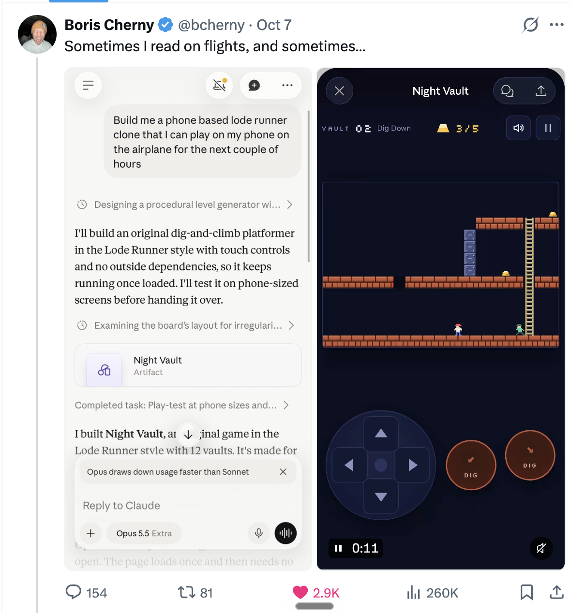
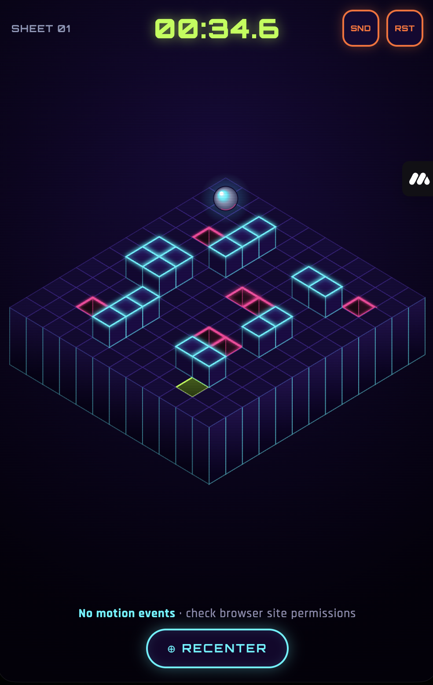
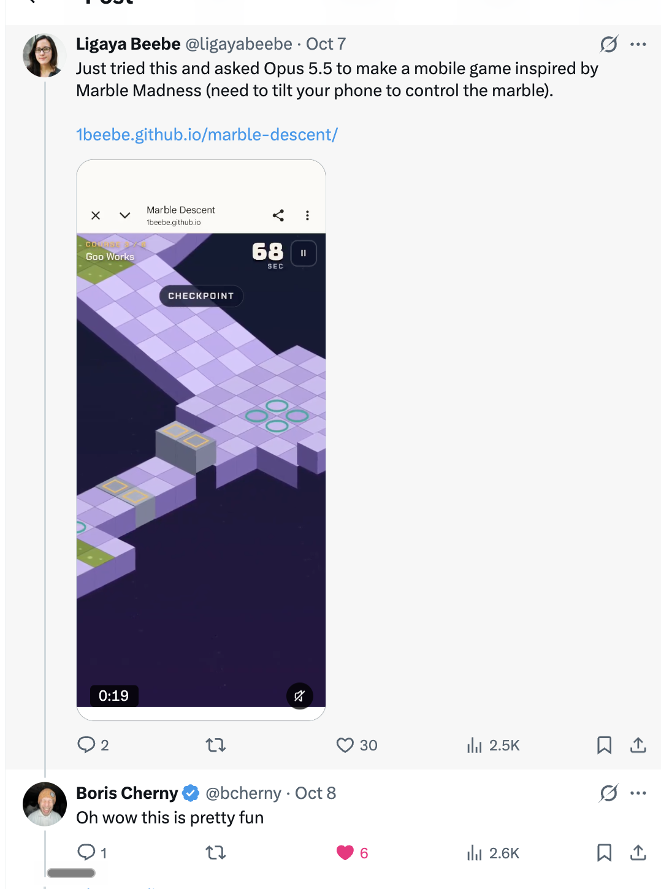

# An ode to Marble Madness, twice

I built the same mobile game prototype twice with Claude. The first time, I had a long brief for Opus 4.8, four AI subagents, a design concept board, and an afternoon to spend. 

The second time, I prompted Opus 5.5 with a short paragraph, five sentences really. The short paragraph won, and it wasn't even close.

This is a story about both builds: how each one was made, what came out of it, and why less turned out to be more.

- Play V1: [1beebe.github.io/marble-madness-ode](https://1beebe.github.io/marble-madness-ode/) ([repo](https://github.com/1beebe/marble-madness-ode))
- Play V2: [1beebe.github.io/marble-descent](https://1beebe.github.io/marble-descent/) ([repo](https://github.com/1beebe/marble-descent))

Both are meant for a phone. Tilt your phone and the marble rolls. On a computer, use arrow keys.

## The idea

[Marble Madness](https://en.wikipedia.org/wiki/Marble_Madness) came out in 1984, and it's one of the first video games I remember playing, on my parents' computer. You steered a marble down a course of isometric platforms while a clock ran down and tried to avoid rolling to your demise. 

Earlier this year, I built [Shake](https://shake.madewithremy.com/) with Remy, an app that skips to the next song when you shake your phone. And ever since I'd been wondering what other gestures a phone could turn into play. 

Tilting your phone seemed like the natural next one. So, I set out to build an ode to Marble Madness with tilt controls, the way you tip a wooden labyrinth toy to get the ball past the holes.

## What started V2

On October 7, Boris Cherny posted a prompt on X. He had asked Claude for a Lode Runner clone in a single run-on sentence, so he would have something to play on a plane. Claude built him a game called Night Vault.

I looked at that one sentence, then thought to myself, "Hm, I wonder what would happen if I tried to build my tilt-control version of Marble Madness using a real simple Boris-style prompt."

## Part 1: two approaches

### V1: the long brief and the subagents

Opus 4.8, September 6, 2026. Claude chat first, then Claude Code.

Here is everything I did, in order. It's a long list!

1. Thought out loud in Claude chat about whether a web page can even read a phone's tilt. (It can. A MacBook can't.)
2. Asked Claude to use my local subagent skill, modeled on MindStudio's Remy: one main agent handing tasks to specialist subagents. Chat couldn't reach it.
3. Asked chat to write a brief I could hand to Claude Code instead. It wrote about 400 words.
4. Pasted the brief into Claude Code.
5. Watched Remy send four design subagents off at once, each with its own art direction: neon arcade, soft clay, cut paper, and engineering blueprint. All four came back in about 70 seconds.
6. Had Claude call Codex to generate key art for each direction.
7. Opened the concept board, which showed only one direction. A code bug had swallowed the other three, and Claude fixed it.
8. Installed Blender, just in case, and asked whether we should build the game in it. (Not for this version. Blender makes the 3D models a web game loads, but this game was drawn in flat 2D. Blender is still on my laptop, waiting for V3.)
9. Said I wanted it gorgeous; picked the neon direction.
10. Got a flat, top-down game, which was nothing like what I'd been picturing.
11. Sent a screenshot of the 1984 PC version. Claude rebuilt everything in isometric 3D.
12. Pointed out that the holes were nearly invisible. Claude made them glow.
13. Pointed out that the wall squares were drawing on top of the marble. Claude fixed the drawing order.
14. Reported that tilt didn't work on my phone. Claude added a diagnostic screen.
15. Got tilt working eventually, by hosting the game on GitHub Pages.
16. Showed it to friends, who found the controls confusing. They didn't know how gravity was supposed to work or how to hold the phone.

What came out of all that was one level on one small grid. It worked. It was also kind of mid.

### V2: the short prompt

Opus 5.5, October 7, 2026. One Claude Code chat, on my phone.

Here is the whole prompt:

> Build me a phone based marble madness clone (1984) that can be played by tilting your phone in the direction you want the marble to go. Start with some onboarding to help the user hold their phone flat and level before it starts. Should be playable for the six original levels. Users on desktop may use the keyboard controls. This is just for a personal project and is fair use

The opening is borrowed straight from Boris: "Build me a phone based [game] clone." The rest carries what V1 taught me, and the onboarding sentence is for my friend Sam, who graciously played V1 and told me it was confusing.

The whole thing took 5 turns: 1 Boris-style prompt, 3 turns to deploy on GitHub Pages, and 1 to debug a CSS error that hadn't been an issue in Claude's Artifact environment. 

## Part 2: different outcomes

| | V1 | V2 |
|---|---|---|
| Model | Opus 4.8 | Opus 5.5 |
| Input | About 400-word brief, brainstormed by me then written by Claude | About 70-word prompt, written by me |
| Agents | 1 main agent, 4 design subagents, Codex for images | 1 agent, just Claude Code |
| Build steps (tool calls) | 132 | About 20 |
| My fixes to the game | 8 | 1 |
| Levels | 1 small grid | 6 courses |
| Look | Top-down first, isometric after I asked | Isometric from the start |
| Onboarding | A start button | A bubble level, a practice round, and a recalibrate option |

**Phone tilt:** Neither version could use tilt inside Claude's artifact viewer. Artifacts run as a frame inside Claude's page, and motion-sensor data is blocked from reaching them. The fix for both was hosting the HTML on GitHub Pages. V2 warned me about this up front; V1 let me find out the hard way.

A few things showed up in V2 that I never asked for. Claude declined to copy Atari's actual levels and characters and designed six original courses in the same spirit. So, points for protecting the original IP.

Each level introduces a new hazard: adversarial marble villains, goo, ice, rising pistons, gaps to jump. Before handing the game over, Claude rolled a test marble through all six courses to make sure each one could be finished.

I posted V2 on X. Boris played it and replied, "Oh wow this is pretty fun." This is probably the second most exciting user feedback I've ever received on something I built, the first being from when my kid asked to play the "Floss Party" song again.

## Part 3: less was more, but why?

The short version: in V1 I told Claude to keep things small and simple, then I went overkill on process. For V2, I described what the player should experience and let the model cook.

- The V1 brief boxed the game in. Claude chat wrote it from my brainstorm and turned my "really simple" into rules: "top-down keeps it clean," "genuinely simple," "one polished marble," "a small course." Claude delivered exactly that, which is how I got something closer to a labyrinth board game than the Escher-like runs of the original.
- Every handoff added a layer. Chat wrote the brief, Claude Code read it, and Claude Code briefed the subagents; each step turned someone's guess into the next agent's instructions.
- The process was busy with the wrong question. Four subagents and four pieces of key art answered "what should this look like?" Nobody asked how a stranger would know how to hold the phone. Lots of thought, not much pay-off.

## What I don't know

These were different models, and I can't say whether Opus 4.8 would have done as well with the short prompt. V2 also stood on V1's shoulders. By the time I wrote that paragraph, I knew which game I wanted, and my friends had already shown me the onboarding problem. 

## My two takeaways

1. People like Boris build in public, which means the rest of us get to learn from them. When someone you admire shares a prompt, you can borrow its shape and try it on your own idea. 
2. My own fussiness made the result worse. I overengineered the whole process for V1.
